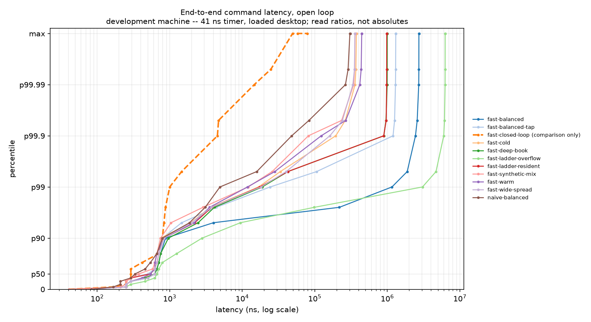
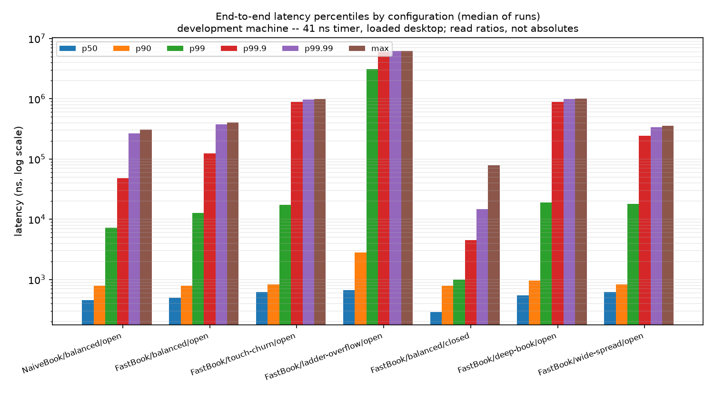

# mini-exchange

A price-time-priority limit order book matching engine, a zero-copy Nasdaq
ITCH 5.0 feed decoder, and the benchmark and validation machinery needed to
believe the numbers — in C++20, with an independent Python oracle and a live
dashboard that cannot perturb the engine it watches.

```text
ITCH 5.0 file ──► feed/ decoder ──┬──► book/ MarketDataBook ──► LOBSTER validation
                                  └──► engine/ MatchingEngine ──► bench/ harness
                                                              └──► viz/ tap → server → UI
```

---

## What is actually established

Being precise about this up front, because "validated" and "benchmarked" are
words people use loosely.

| Claim | Status |
|---|---|
| Three independent implementations produce byte-identical event streams | **yes** — 100,000 random sequences × 1,000 commands |
| `FastBook` agrees with `NaiveBook` on every flow pattern including pathological ones | **yes** |
| The reconstruction matches an independently-written book, message by message, 10 levels | **yes** — on a synthetic LOBSTER pair |
| The reconstruction matches a **real** LOBSTER sample day | **no** — no sample day has been downloaded |
| The divergence table against real ITCH order flow | **no** — same reason |
| Latency percentiles on a machine that can resolve them | **no** — see *Results* |
| A screenshot of the dashboard | **no** — see *The dashboard* |

Everything in the "no" rows is implemented, tested, and one command away from
running. It has not been run, and the documents say so rather than implying
otherwise.

---

## Correctness

Three implementations of the matching semantics agree, byte for byte, on the
canonical event stream:

| | What it is |
|---|---|
| `NaiveBook` | `std::map` of price to `std::list`; obvious, never optimised, never deleted |
| `FastBook` | price ladder, intrusive FIFOs, slab pool, hierarchical best-price bitset |
| `pyref/` | written from `docs/matching-semantics.md`, not from the C++, and connected to it only through text files |

```bash
# in-repo: the same engine over both books, every flow pattern
./build/release/tools/engine_replay --synthetic 200000 --book both --diff \
    --pattern ladder-overflow --max-orders 1048576

# cross-language: the Python oracle against the compiled engine
python -m pyref.differential --engine build/release/tools/engine_replay \
    --book fast --seeds 1000 --length 1000
```

A disagreement is minimised to a **1-minimal** reproducer before it is
reported: binary search on the prefix, then delta-debugging chunk removal,
then single-command removal repeated to a fixpoint. Removing any remaining
command makes the failure disappear.

**The differential suite also injects known bugs and asserts they are caught.**
One of them was *not*: "size-down keeps time priority" survived, because the
flow generator re-randomised the price on every replace and therefore almost
never produced a replace at the order's own price. The one replace rule that
keeps priority was going untested by a suite that had been green for every
seed tried. That is the argument for mutation testing in one paragraph.

---

## Results

**No publishable latency numbers exist yet.** The development machine is an
Apple M1 Max, whose architectural counter ticks at **23,999,995 Hz — 41 ns per
tick** — which is coarser than the operation being measured. `engine_bench`
detects this and prints a five-line banner on every run saying the results are
development-only. Publishable numbers come from x86-64 Linux with an invariant
TSC, and no such machine has been run.

What follows are **development-machine A/B figures**: useful as ratios,
meaningless as absolute percentiles. The machine report is committed next to
them in `bench/results/dev-m1max/machine.txt`, and every CSV row carries the
build, git SHA, timing backend, tap state, flow mix, seed and pool sizing.

### Per-operation cost (Google Benchmark, median of 3, `-O3`)

| Benchmark | | |
|---|---:|---|
| Realistic mixed flow, `NaiveBook` | **14.6 M** cmd/s | the committed "before" |
| Realistic mixed flow, `FastBook` | **21.0 M** cmd/s | **1.44×** |
| `FastBook`, ladder-resident prices | 22.2 M cmd/s | its best case |
| `FastBook`, ladder-overflow prices | 9.8 M cmd/s | **its worst case — slower than `NaiveBook`** |
| Cancel at the **head / middle / tail** of a 4096-deep level | 60.5 / 60.1 / 60.1 ns | identical, which is the whole claim |
| One partial fill (no teardown at all) | 17.4 ns | |
| Replace, same price (keeps priority) | 9.7 ns | |
| Replace, crossing price | 98.2 ns | |
| Next occupied level, hierarchical bitset | **3.60 ns** | |
| Next occupied level, linear scan of the same bits | **5,004 ns** | **1,390×** |
| Pool allocate + free | 1.52 ns | |
| Hash find (hit / miss) | 2.97 / 1.06 ns | dense sequential ITCH ids |
| SPSC ring, 64-element batch | 0.36 ns / item | |
| ITCH decode, `switch` dispatch | **105 M** msg/s, 3.0 GiB/s | what ships |
| ITCH decode, 256-entry function-pointer table | 98.7 M msg/s | 0.94× |
| ITCH decode, computed goto (GNU extension) | 120 M msg/s | 1.15×, but not allowed in a header |
| Decode one Add Order message | 1.61 ns | |
| 48-bit big-endian load, unaligned | 0.32 ns | one instruction |

Cancel being **identical at the head, the middle and the tail** of a
4096-deep price level is the intrusive doubly-linked list doing its job, and
it is the single measurement that most justifies `FastBook` existing — real
flow is dominated by cancels and they do not arrive in queue order.

The overflow row is the other one worth looking at. `FastBook`'s resident
ladder is O(1); prices outside its 131,072-tick window fall into a
`std::map`, and on flow that lives there it runs at **44% of its own best
case** and slower than the book it replaces. That is a real limitation of this design and it belongs
in the results table rather than a footnote. See `docs/design-decisions.md`
DD-022.

### End-to-end, open loop

Reproduce everything below with one command:

```bash
./scripts/bench_all.sh
```

| Configuration | throughput | p50 | p99 | p99.9 | max | sched. misses |
|---|---:|---:|---:|---:|---:|---:|
| `NaiveBook`, balanced, tap off | 1.60 M/s offered | 458 ns | 7.2 µs | 48.0 µs | 308 µs | 0.68% |
| `FastBook`, balanced, tap off | 1.60 M/s offered | 520 ns | 11.9 µs | 102 µs | 381 µs | 0.76% |
| `FastBook`, tap **on** | 1.60 M/s offered | 499 ns | 14.3 µs | 770 µs | 841 µs | 1.02% |
| `FastBook`, **ladder-overflow** | 1.60 M/s offered | 666 ns | **3.14 ms** | 5.98 ms | 6.25 ms | 0.78% |
| `FastBook`, cold book (0 resting) | 1.60 M/s offered | 500 ns | 11.3 µs | 50.1 µs | 361 µs | 0.76% |
| `FastBook`, warm book (100k resting) | 1.60 M/s offered | 500 ns | 14.6 µs | 122 µs | 425 µs | 1.06% |

Service time only (no offered rate — dequeue to handler return, a *different
quantity*, never to be quoted as latency):

| | throughput | p50 | p99 | p99.9 |
|---|---:|---:|---:|---:|
| `NaiveBook` | 3.84 M cmd/s | 83 ns | 499 ns | 1.67 µs |
| `FastBook` | 3.75 M cmd/s | 166 ns | **416 ns** | **1.29 µs** |



*Percentile against latency, log x, with the percentile axis compressed
towards 100 so each decade of nines gets equal space. The dashed line is the
closed-loop run — see below.*



### The one number worth the whole harness

Same engine, same flow, same machine, same run length — only the load
generator differs:

| | p50 | p99 | p99.9 | max |
|---|---:|---:|---:|---:|
| **Open loop** (latency from the *intended* send time) | 520 ns | 11.9 µs | **102 µs** | 381 µs |
| **Closed loop** (send, wait, send) | 291 ns | 1.0 µs | **4.5 µs** | 79 µs |

The closed-loop harness reports a p99.9 **22× better** than the open-loop one
on identical work. Neither is lying about what it measured; the closed loop
simply stops offering load exactly when the system is least able to serve it,
so the queueing it causes never enters its own distribution. **This is
coordinated omission**, and it is the dashed line sitting an order of
magnitude to the left of everything else in the chart above. Any order-book
benchmark that does not say which of these two it ran has not told you its
most important number.

### Three things these numbers say that are not flattering

2. **`FastBook`'s tail is worse than `NaiveBook`'s here** (p99 11.9 µs against
   7.2 µs) even though its *service time* tail is better (416 ns against
   499 ns) and its microbenchmark throughput is 1.68× higher. The likely cause
   is its memory footprint — 40 MB of pool, index and ladder against
   `NaiveBook`'s lazily-grown few — on a machine that is already thrashing.
   That is a hypothesis, not a finding; it needs a quiet machine to settle.
3. **The overflow path is 263× worse at p99** than the resident path. See the
   per-operation table above.
4. **The tap costs a real amount**: p99.9 goes from 102 µs to 770 µs with it
   compiled in. That is why it is a compile-time option, why every result row
   carries its state, and why the harness exits rather than printing a
   "tap ON" number with the tap silently off.


### What the harness refuses to do

* **No mean without a distribution.** There is no API to ask for p99 alone;
  `summary()` always carries p50, p90, p99, p99.9, p99.99 and max together.
* **Nothing is subtracted.** The timer's own read overhead is measured and
  published so a reader can see the floor, and left in every sample.
* **Saturation is announced.** A run whose schedule misses exceed 1% prints
  `SATURATED: these percentiles describe the harness` next to the numbers,
  because in that regime they do.
* **A "tap ON" run with the tap off exits** rather than printing a number.

`docs/benchmarking.md` has the full methodology, including why the open-loop
arrival schedule matters and what coordinated omission does to a closed-loop
harness.

---

## Validation

`MarketDataBook` reconstructs the exchange's book from the message stream and
is compared against a published book **after every single message** at ten
levels on both sides — not at a coarser granularity, because a reconstruction
can be wrong for ten thousand messages and right again by the time anyone
looks.

```bash
./build/release/tools/lobster_check \
    --messages replay/tests/data/SYNTH_2026-09-13_34200_57600_message_10.csv \
    --book     replay/tests/data/SYNTH_2026-09-13_34200_57600_orderbook_10.csv \
    --levels 10
# VALIDATION PASSED: 1000 messages, 1000 book rows compared at 10 levels per
# side, zero mismatches
```

The fixture's orderbook file was produced by `pyref/lobster_check.py`, an
independently written Python reconstruction — so this is a genuine
cross-implementation check, the same shape as the engine's three-way
agreement. It deliberately contains **876 crossed or locked states across
1000 messages**, because that is the thing a naive reconstructor dies on:

> The no-crossed-book invariant is a property of the **matching engine**, not
> of a market data feed. A replace can move an order through the opposite
> side, and the book stays crossed until the other side reacts. Real feeds do
> this on a normal day.

**This is not a claim about real data.** To make it one:

```bash
./scripts/fetch_data.sh lobster
./build/release/tools/lobster_check --messages data/lobster/..._message_10.csv \
                                    --book data/lobster/..._orderbook_10.csv
```

`docs/validation.md` records what has and has not been run, and why the
ITCH↔LOBSTER cross-check has not happened (the freely available samples do not
overlap in date).

---

## Divergence: ITCH flow through our engine

**ITCH is a market data feed. It is not an order entry stream.** It reports
what Nasdaq already matched. You cannot replay it through a matching engine
and expect identical fills, and a project claiming to is either confused or
being dishonest.

What `tools/inject` does instead: take the `A`/`F` adds as an **order arrival
process**, apply `X`/`D`/`U` by reference, and compare the trades *our* engine
generates against the `E`/`C`/`P` executions in the feed — then name and
quantify every difference.

The §13.3 table is **not filled in**, because no real ITCH day has been
downloaded. The tool runs; the only file available here is synthetic, with
adds and executions generated independently and no matching logic connecting
them, so its "62.8% unexplained" says nothing about this engine and publishing
it would be worse than publishing nothing. `docs/divergence.md` has the
expected divergence classes — hidden liquidity, auction crosses, odd lots,
publication-vs-arrival ordering, routed-away liquidity — and the command to
produce the table.

---

## The dashboard

```bash
./scripts/demo.sh --mock     # no C++ build, no market data
./scripts/demo.sh            # engine → shm tap → server → browser
```

**No screenshot or GIF is committed.** Producing one needs a browser session
this environment could not drive: the available Chrome window was occluded,
which freezes the page's timers, and every capture timed out against a
renderer that was alive but frozen. Rather than commit a mock-up,
`viz/ui/README.md` says the picture is missing and gives the commands.

The UI is instead verified by mounting the whole dashboard in jsdom against a
stubbed WebSocket and feeding it the committed sample recording — byte for
byte the file the mock server replays — asserting the canvases issue draw
calls, the tape renders newest-first, transport commands reach the socket, and
**zero frames are rejected**. That last assertion is the drift check between
the TypeScript and Python halves of the wire schema, which otherwise fails as
a silently blank panel rather than an error.

The tap's contract is about what it does to the *engine*:

* the engine's write is one bounded store into shared memory — no syscalls, no
  locks, no allocation, and a full ring increments a drop counter and returns;
* **killing the reader mid-run does not perturb the producer**, measured:
  14,069 µs with a live reader, 2,426 µs over identical work after the reader
  was killed. Losing the reader makes the producer *faster*, never slower;
* the tap's own cost is published, not waved away: 4.27 M cmd/s with
  `MINIEX_TAP=OFF` against 3.39 M with it on, everything else identical;
* Python cannot drain a C++ engine at a million commands a second and does not
  pretend to. Past a configured backlog the reader **skips forward** and counts
  what it skipped, rather than showing a lagging replay while claiming to be
  live. The count is published and the UI shows it in red.

---

## Build and run

Requires CMake ≥ 3.24, Ninja, and a C++20 compiler (Clang ≥ 16 or GCC ≥ 12).
GoogleTest, Google Benchmark and HdrHistogram are fetched by CMake; nothing is
vendored.

```bash
cmake --preset release && cmake --build build/release
ctest --preset release                     # 283 tests, ~20 s from a clean clone

# the Python oracle and the viz server
python3.11 -m venv .venv && .venv/bin/pip install -e '.[dev]'
.venv/bin/python -m pytest                 # 90 tests

# the UI
cd viz/ui && npm install && npm test       # 32 tests
```

Presets: `dev`, `ubsan`, `asan`, `tsan`, `fuzz`, `release`, `release-tap`,
`release-portable`.

### Tools

| Tool | What |
|---|---|
| `engine_replay` | run commands through the engine; `--record`/`--verify` for determinism, `--book both --diff` for the in-repo differential |
| `engine_bench` | the open-loop latency harness |
| `itch_stats` | message-type histogram, time span, decode throughput |
| `book_dump` | reconstruct a symbol and print the top N levels |
| `lobster_check` | the message-by-message LOBSTER validation |
| `tape_print` | the trade tape, with provenance per print |
| `flow_profile` | the empirical flow mix and order-lifetime distribution |
| `inject` | ITCH order flow into the engine, and the divergence table |
| `tap_producer` | the engine writing into a shared-memory tap |

---

## What I got wrong

Everything here was found by a test, a measurement or a count — not by reading
the code. The list is the most honest thing in this README.

1. **A CI job was red and I had not run it.** `check_no_floats.sh` — the grep
   that enforces "no floating point in the price-carrying layers" — matched
   the words *"double free"* inside an `assert` message, and had therefore
   been failing since the commit that introduced it. Writing a guard is not
   the same as running it.

2. **A test passed locally and failed in a fresh clone.** `.gitignore`
   carried an unanchored `data/`, intended for downloaded market data, which
   also matched `replay/tests/data/` — so the committed LOBSTER validation
   fixture was never actually committed. Found by cloning the repository and
   running the tests in the clone, which is the only way that class of bug is
   ever found.

3. **The cycle counter silently returned garbage on Apple Silicon.**
   `asm("isb; mrs %0, cntvct_el0")` assembles to the `isb` alone on Apple's
   integrated assembler, because `;` introduces a comment there. The
   "timestamps" were whatever happened to be in the register. Caught by a
   monotonicity test on the first run.

4. **The flow generator was benchmarking an empty book.** The default mix had
   removals at 55% and additions at 40%, so the live order set drained to
   single digits within a few thousand commands and every subsequent cancel
   was substituted with an add. Every "before" number would have described a
   book with five orders in it.

5. **Two microbenchmarks were measuring Google Benchmark.** `CancelHead`
   reported 98 µs per cancel. The real figure is 28 ns; the rest was
   `PauseTiming`/`ResumeTiming` rebuilding the book on every iteration.

6. **The differential suite had a hole and was green anyway.** The mutation
   test for "size-down keeps time priority" was not caught, because the flow
   generator re-randomised the price on every replace and therefore almost
   never produced a replace at the order's own price.

7. **The event formatter wrote 204 bytes into a 192-byte buffer.** Caught by
   a test that fills every field with its maximum value — which existed only
   because the spec says to assert struct sizes rather than assume them.

8. **The normalised ITCH event left its padding indeterminate**, so `memcmp`
   of two events was order-dependent: the dispatch-equivalence test passed in
   isolation and failed in a full run.

9. **The shrinker stopped at "smaller", not minimal**, and produced
   16-command reproducers full of irrelevant commands — leaving the reader to
   do the work the shrinker existed to do.

10. **The benchmark made `FastBook` look slower than `NaiveBook`.** It sized
    the pool at the compile-time ceiling of 4 M orders: a 256 MB slab plus a
    128 MB index, nearly 400 MB of cold pages to fault through, against a
    `NaiveBook` that allocates lazily. An artefact of the harness presented as
    a fact about the data structures.

11. **`FastBook`'s open-loop tail was worse than `NaiveBook`'s** even though
    its service time was better — first-touch page faults on 40 MB of pool,
    index and ladder, invisible to a microbenchmark and fully visible to a
    tail-latency measurement. Pre-faulting at construction is the fix
    (DD-034), though this machine is too noisy to settle the size of the win.

12. **The tap could only be created once per boot.** A POSIX shm object
    outlives its process, and on macOS `ftruncate` on an already-sized object
    fails with `EINVAL`, so the second run reported "cannot open the tap
    segment" with no hint that a previous run was the cause.

13. **React's StrictMode left orphaned WebSockets reconnecting.** Four live
    connections to a server that should have had one, found by counting
    established sockets while the page was open.

14. **Vite's silent port fallback meant the first screenshot attempt captured
    a different project's dashboard**, because 5173 was already taken.

15. **The Python tap reader's magic constant was mistyped by one nibble**, and
    the symptom was "not a miniex tap segment" against a segment that plainly
    was one. It is now derived from the bytes of `"MINIEXTP"`.

## What I would do next, in order

1. **Run it on x86-64 Linux.** Everything needed is committed —
   `scripts/bench_all.sh`, `scripts/machine_report.sh`, the pinning flags, the
   TSC checks. What is missing is a machine whose clock can resolve the thing
   being measured and that is not simultaneously running a desktop. Until
   then this repository has ratios, not latencies.

2. **Download a real ITCH day and a real LOBSTER day.** That fills in the
   validation claim, the divergence table and the measured flow mix — three of
   the "no" rows at the top of this README — and it is a `fetch_data.sh` away.

3. **Fix the overflow path**, the one place `FastBook` is worse than the book
   it replaces (263× at p99). A second, coarser ladder over a wider window
   would keep the O(1) property where the red-black tree currently costs 2×,
   and the benchmark to prove or disprove it already exists.

4. **Settle the `PriceLevel` padding question** (DD-021) with a
   `MINIEX_PAD_PRICE_LEVEL=OFF` run. The argument cuts both ways and the
   variable exists purely so the measurement can be taken; a measured negative
   result would be published.

5. **Commit a flamegraph and `perf stat` output**, and the dashboard
   screenshot. The first two need `perf`, which needs Linux — the same blocker
   as (1). The third needs a browser session this environment could not drive.

---

## Scope boundaries

Deliberately **not** implemented, and explained in
`docs/design-decisions.md`:

* multi-threaded matching — the core is single-threaded by design, and the
  correct way to add concurrency is multi-symbol sharding, not locks;
* network transport, multicast, gap recovery, FIX order entry (MoldUDP64
  framing is parsed only as far as reading files needs, and for the sequence
  arithmetic that gap detection is made of);
* persistence, crash recovery, clustering;
* kernel bypass (DPDK / Onload / `io_uring`);
* auction and cross matching — `Q` messages are consumed and reported, never
  replicated;
* options, futures, or anything that is not a single-symbol equity book;
* any connection to real money.

## Documentation

| Document | What |
|---|---|
| `docs/architecture.md` | module boundaries, threading model, wire formats |
| `docs/matching-semantics.md` | the behavioural contract, and the oracle's source |
| `docs/design-decisions.md` | 33 decisions: context, options, choice, measured consequence |
| `docs/benchmarking.md` | the methodology, and what the harness refuses to do |
| `docs/validation.md` | what has and has not been validated |
| `docs/divergence.md` | why ITCH replay is not what it sounds like |
| `docs/itch-notes.md` | the protocol's traps, and the dispatch measurements |

## Licence

MIT. See `LICENSE`.
